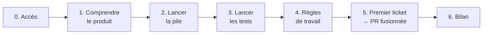

# Rejoindre Luniqo

Le parcours d'un nouvel arrivant, du premier accès à sa première PR fusionnée.
Il s'adresse à un développeur qui rejoint l'équipe, stagiaire compris.

Ce fichier ne recopie pas la documentation : il dit **dans quel ordre** la lire
et **comment vérifier** que chaque étape a marché. Si une étape échoue, le
signaler à l'équipe : un onboarding qui bloque est un défaut du projet, pas du
nouvel arrivant.

## Le parcours en un coup d'œil



| Étape | Durée indicative | Terminée quand |
|---|---|---|
| [0. Accès](#0-obtenir-les-accès) | 15 min | le dépôt est forké (stagiaire) ou ouvert en écriture (équipe), le ticket est lisible |
| [1. Comprendre le produit](#1-comprendre-le-produit) | 45 min | on sait expliquer le parcours central et les 4 rôles |
| [2. Lancer la pile](#2-lancer-la-pile-docker) | 30 min | `/api/health` répond, Swagger et le front v2 s'affichent |
| [3. Lancer les tests](#3-lancer-les-tests) | 45 min | `pytest` (avec la base de test) et les tests du front sont verts, Storybook s'ouvre |
| [4. Règles de travail](#4-apprendre-les-règles-de-travail) | 30 min | on sait nommer une branche et ce que contient une PR |
| [5. Premier ticket](#5-premier-ticket--de-la-branche-à-la-pr-fusionnée) | selon le ticket | la PR est fusionnée dans `develop` |
| [6. Bilan](#6-bilan-de-fin-de-stage) | 1 h | rapport rendu, retour du maître de stage reçu |

## 0. Obtenir les accès

Chacun reçoit **le minimum utile**, et rien n'est à retirer à la fin d'un stage.

| Outil | Florent | Thomas, Pauline, Julien | Stagiaire |
|---|---|---|---|
| GitHub [`zharrow/Luniqo`](https://github.com/zharrow/Luniqo) | administrateur | écriture | lecture (le dépôt est public) ; PR depuis son fork ; CI lancée après l'accord d'un membre de l'équipe |
| Jira, projet **LUN** | administrateur | administrateur | aucun compte ; son US est recopiée dans une issue GitHub |
| Vercel, Supabase (v1) | propriétaire | aucun | aucun |
| Secrets (`.env`) | les siens | les siens | les siens, générés en local ; aucun secret partagé |

Pourquoi le stagiaire n'a ni droit d'écriture ni compte Jira : un dépôt GitHub
personnel n'a pas de rôle intermédiaire (un collaborateur peut pousser,
supprimer des branches, approuver les PR des autres), et sur l'offre gratuite
de Jira tout compte administre tous les projets. Le fork et l'issue donnent tout
ce qu'il faut pour livrer, sans ces risques (décision du 2026-11-17, reconduite
le 2026-11-20 pour le stage suivant : toujours aucun compte Jira).

| Outil | Pour | Comment l'obtenir | Vérifier |
|---|---|---|---|
| GitHub | code, PR, CI | équipe : invitation de Florent ; stagiaire : bouton **Fork** sur le dépôt | le dépôt (ou le fork) s'ouvre, l'onglet *Actions* est visible |
| Le ticket | savoir quoi livrer | équipe : board Jira ; stagiaire : [issues étiquetées `stage`](https://github.com/zharrow/Luniqo/issues?q=is%3Aissue+label%3Astage) | on peut le lire et y poser une question en commentaire |
| Docker avec Compose v2 | lancer toute la pile | installation locale | `docker compose version` affiche une version 2 |
| Python 3.14 | tests de l'API | installation locale | `python3 --version` |
| Node 22.12 ou plus, avec `corepack` | front v2 | installation locale | `node --version`, puis `corepack pnpm --version` dans `front/` affiche 11.x |

L'équipe et qui relit quoi :

| Membre | Rôle | Le solliciter pour |
|---|---|---|
| Florent | Chef de projet, maître de stage | accès, priorités, contenu d'un ticket, recette |
| Thomas | Développeur fullstack | relecture front et back |
| Pauline | Développeuse frontend | relecture front, design system |
| Julien | Développeur backend | relecture API, base de données |

## 1. Comprendre le produit

Lire dans cet ordre :

1. [README.md](README.md), section **Le projet** : d'où vient Luniqo, le parcours
   central, les 4 rôles, les deux versions (v1 gelée, v2 en cours).
2. [docs/produit/PERSONAS.md](docs/produit/PERSONAS.md) : pour qui on construit.
3. [docs/produit/STORY-MAP.md](docs/produit/STORY-MAP.md) : ce que contient le MVP
   et ce qui vient après.
4. [ADR-001](M2/decisions/ADR-001-reecriture-backend.md) : pourquoi la v2 existe ;
   [ADR-002](M2/decisions/ADR-002-front-v2.md) : pourquoi le front v2 est en React + Vite.

**Vérifier** : savoir répondre sans relire à ces trois questions.

- Que se passe-t-il quand un employé pointe le départ d'un enfant ?
- Quelle différence entre `owner`, `employee`, `guardian` et `developer` ?
- Où vit la logique métier en v2, et pourquoi pas dans le navigateur ?

## 2. Lancer la pile Docker

```bash
# Équipe : clone du dépôt. Stagiaire : clone de son fork, puis le dépôt d'origine en « upstream ».
git clone https://github.com/<compte>/Luniqo.git
cd Luniqo
git remote add upstream https://github.com/zharrow/Luniqo.git   # stagiaire seulement
git fetch upstream && git switch -c develop upstream/develop     # stagiaire ; l'équipe est déjà sur develop

# Mot de passe des comptes de démonstration : fichier .env à la racine, jamais versionné.
echo "API_SEED_DEMO_PASSWORD=$(openssl rand -hex 12)" > .env

cd docker
docker compose --env-file .env --env-file ../.env up -d --build --wait
docker compose ps
```

**Sous Windows** : lancer ces commandes dans Git Bash (installé avec Git) ou
WSL. Le dépôt impose des fins de ligne LF ([.gitattributes](.gitattributes)) : un
clone neuf fonctionne tel quel. Un clone fait avant le 2026-11-20 se remet à
niveau, sans travail en cours, par `git rm -r --cached -q . && git reset --hard`.

**Vérifier** :

- [ ] `docker compose ps` montre `db`, `api`, `front` et `web` à l'état `healthy` ;
- [ ] <http://localhost:8080> affiche la page de connexion du front v2 ;
- [ ] <http://localhost:8080/api/health> répond ;
- [ ] <http://localhost:8080/api/docs> affiche la documentation Swagger de l'API ;
- [ ] la connexion avec un compte de démonstration fonctionne.

Les comptes de démonstration sont listés dans le
[README](README.md#option-1--toute-la-pile-avec-docker-le-plus-simple) ; leur mot
de passe est celui du `.env`. Les données sont **synthétiques**, avec des
adresses en `.test`. Un compte de direction doit enregistrer une application
d'authentification (TOTP) à sa première connexion.

| Problème fréquent | Cause | Solution |
|---|---|---|
| Un service reste `unhealthy` | il attend la base ou l'API | `docker compose logs <service>` |
| La connexion refuse le mot de passe de démonstration | mot de passe de moins de 15 caractères, ou contenant un `$` (Compose le lit comme une variable) : l'API n'a créé aucun compte | corriger `.env`, puis `docker compose down -v` et relancer ; le journal de l'API dit « SEED_DEMO_PASSWORD refusé » |
| Le port 8080 est déjà pris | un autre programme l'utilise | l'arrêter, ou lancer avec un autre port : `WEB_PUBLISHED_PORT=8081 docker compose …` |
| `--env-file ../.env` introuvable | le `.env` de la racine n'existe pas | le créer (commande ci-dessus) |
| Un conteneur s'arrête au démarrage (`/bin/sh^M`, secret refusé) | fichiers en CRLF : clone Windows fait avant `.gitattributes` | remise à niveau ci-dessus, puis `docker compose build` |

Le détail de la conteneurisation (images, limites, ordre de démarrage) est dans
[docker/README.md](docker/README.md).

## 3. Lancer les tests

### L'API

```bash
cd api
python3 -m venv .venv && . .venv/bin/activate
pip install -r requirements-dev.txt
pytest                      # tests unitaires, sans base
ruff check .                # lint
scripts/test-db.sh up       # PostgreSQL jetable (image construite à l'étape 2) ; copier la ligne « export TEST_DB_… » affichée
pytest                      # unitaires et intégration
scripts/test-db.sh down
```

**Sous Windows**, les tests d'intégration ne tournent pas directement : le pilote
asynchrone de PostgreSQL refuse la boucle d'évènements de Windows, et
`scripts/test-db.sh` passe à Docker des chemins de Git Bash. Lancer à la place
`docker/pipeline.sh --no-deploy` depuis la racine : lint puis tests unitaires et
d'intégration, dans des conteneurs, comme la CI.

Lire ensuite [api/README.md](api/README.md) : structure de l'API, routes, qui
accède à quoi.

### Le front v2

```bash
cd front
corepack pnpm install                       # pnpm 11, version fixée dans package.json
corepack pnpm exec playwright install chromium
corepack pnpm lint && corepack pnpm typecheck && corepack pnpm test
corepack pnpm storybook                     # http://127.0.0.1:6006
corepack pnpm dev                           # http://localhost:5173, l'API passe par la pile de l'étape 2
```

Si des tests du navigateur dépassent leur délai (machine chargée, jamais le même
test), relancer avec `corepack pnpm test --no-file-parallelism`. Ces tests
chargent les styles réels de l'application ([test/browser-setup.ts](front/test/browser-setup.ts)) :
une vérification en 800 × 600 porte sur le vrai rendu.

`pnpm install` refuse les versions publiées depuis moins de 24 heures et les
scripts d'installation non autorisés : c'est une protection contre les paquets
compromis, pas une panne. Lire ensuite [front/README.md](front/README.md) :
structure, scripts, pièges connus.

**Vérifier** :

- [ ] `pytest` est vert sans base, puis avec `TEST_DB_*` exporté ;
- [ ] `ruff check .` ne signale rien ;
- [ ] `lint`, `typecheck` et `test` du front sont verts ;
- [ ] Storybook affiche les composants de base (`Interface/…`) et ceux des écrans (`Présences/…`, `Mode tablette/…`…).

C'est ce que fait la CI ([ci.yml](.github/workflows/ci.yml)) : si c'est vert en
local, la CI le sera aussi. Elle vérifie en plus que le contrat de l'API du
front est à jour : après tout changement d'une route, lancer
`corepack pnpm api:types` dans `front/`, avec l'environnement Python de l'API activé.

## 4. Apprendre les règles de travail

Lire [CONTRIBUTING.md](CONTRIBUTING.md) en entier. L'essentiel :

| Sujet | Règle |
|---|---|
| Ticket | Tout travail part d'un ticket `LUN-<n>` dans Jira (pour le stagiaire : son issue GitHub, qui porte la clé) |
| Branche | `<préfixe>/LUN-<n>-description-courte`, depuis `develop` ; préfixes `feat/`, `fix/`, `docs/`, `infra/`, `chore/` |
| Commit | [Conventional Commits](https://www.conventionalcommits.org/fr/v1.0.0/) en français, clé en fin de ligne : `feat(api): pointage groupé (LUN-65)` |
| PR | vers `develop`, titre `type(portée): description (LUN-<n>)` avec la clé de la branche, [modèle](.github/pull_request_template.md) rempli, une PR par ticket ; la CI le vérifie |
| Relecture | au moins une approbation enregistrée sur GitHub ; front par Pauline ou Thomas, back par Julien ou Thomas |
| Erreurs | une erreur de l'API se déclare (code stable, message, Swagger) et s'affiche à l'endroit de l'action, avec ce qu'on peut faire : [ERREURS.md](docs/projet/ERREURS.md), § 4 à 6 |
| Petit écran | chaque écran se vérifie en 800 × 600 (tablette, petit portable) |
| Fini | la [Definition of Done](CONTRIBUTING.md#5-definition-of-done) est cochée |

Les statuts Jira **avancent seuls** pour l'équipe : créer la branche passe le
ticket « En cours », ouvrir la PR le passe « En revue », la fusion le passe
« Intégré ». Pour le stagiaire, la branche vit dans son fork et il n'a pas de
compte Jira : le maître de stage passe la story **et ses sous-tâches**
« En cours » à la main. La PR, qui porte la clé de la story, fait avancer la
story, **pas ses sous-tâches** : le maître de stage les passe « Intégré » à la
fusion (au premier stage, elles étaient restées « À faire »). L'issue se ferme
par la ligne `Closes #<n>` de la PR. Le
fonctionnement complet est dans [docs/projet/JIRA.md](docs/projet/JIRA.md).

**Le design system du front v2** :

- les composants de [front/src/components/ui](front/src/components/ui) (boutons,
  champs, cartes, alertes, fenêtres), visibles dans Storybook : on les
  réutilise, on n'en recrée pas ;
- les couleurs, rayons et ombres sont des jetons définis dans
  [front/src/styles/index.css](front/src/styles/index.css), utilisés par les
  classes Tailwind (`bg-primary`, `text-muted-foreground`…) : jamais de couleur
  en dur ;
- les principes (palette pastel « Douceur Professionnelle », grands boutons en
  mode tablette, états de chargement, vide et erreur) sont dans
  [docs/DESIGN-SYSTEM.md](docs/DESIGN-SYSTEM.md), écrit pour la v1 : ses
  composants et ses icônes ne s'appliquent pas au front v2.

Trois règles ne se discutent pas ([CONTRIBUTING, §6](CONTRIBUTING.md#6-règles-propres-au-projet)) :

- **la v1 est gelée** : on ne modifie la racine du dépôt (Next.js) que pour un correctif de sécurité ;
- **données synthétiques uniquement** : jamais de vraies données d'enfants, de familles ou de salariés, le dépôt est public ;
- **aucun secret dans le dépôt** : mots de passe et clés dans des `.env` non versionnés.

**Vérifier** : la CI refuse une branche mal nommée ou une PR sans clé
([pr-conventions.yml](.github/workflows/pr-conventions.yml)). Savoir dire quel
nom aurait la branche du ticket LUN-65 « mode tablette » (`feat/LUN-65-mode-tablette`).

## 5. Premier ticket : de la branche à la PR fusionnée

Le premier ticket est choisi par le chef de projet. Pour un stage, c'est une
story fullstack : une partie API, une partie interface, des tests.

1. **Lire le ticket** et ses critères d'acceptation. Poser ses questions en
   commentaire du ticket (ou de l'issue), pas en message privé : la réponse
   profite à tous.
2. **Créer la branche** depuis `develop` à jour.
   ```bash
   # Équipe
   git switch develop && git pull
   git switch -c feat/LUN-<n>-description-courte
   git push -u origin feat/LUN-<n>-description-courte    # le ticket passe « En cours »

   # Stagiaire (fork) : partir de develop du dépôt d'origine
   git fetch upstream
   git switch -c feat/LUN-<n>-description-courte upstream/develop
   git push -u origin feat/LUN-<n>-description-courte    # pousse dans le fork
   ```
3. **Coder côté API** en suivant la structure décrite dans [api/README.md](api/README.md).
   Toute route d'une crèche passe par les dépendances d'accès (`ReadableNursery`,
   `ManagedNursery`) : c'est ce qui isole les données d'une crèche à l'autre.
   Une erreur se déclare une fois : `ErrorSpec` (statut, code stable, message
   en français) et `@raises` sur la route. Elle apparaît alors dans Swagger, et
   le test « erreur levée = erreur documentée » échoue si on l'oublie (marche à
   suivre : [ERREURS.md § 6](docs/projet/ERREURS.md#6-ajouter-une-erreur--la-marche-à-suivre)).
   Régénérer ensuite le contrat du front (`corepack pnpm api:types`).
4. **Coder côté interface** dans `front/src/features/<domaine>/`, avec les
   composants du design system (étape 4) ; la route va dans `front/src/routes/`.
   Chaque état d'un composant (chargement, vide, valeurs, erreur) a sa story.
   Une erreur s'affiche à l'endroit de l'action avec `ActionError`
   (`front/src/components/action-error.tsx`) : message de l'API, « Réessayer »
   sur une panne, compte à rebours sur une 429 ; jamais de notification
   flottante.
5. **Écrire les tests** qui prouvent la nouvelle règle, y compris les cas
   d'erreur (accès refusé, donnée invalide) : pytest pour l'API (unitaires et
   intégration), Vitest avec MSW pour le front. Les réponses d'erreur viennent
   de `front/test/handlers/errors.ts` (`apiErrors`, `reply`, `raised`), jamais
   écrites à la main ; un composant qui appelle l'API a ses stories
   `ErreurServeur` et `HorsLigne`. Le petit écran se vérifie dans un test du
   navigateur avec `page.viewport(800, 600)` (styles réels chargés).
6. **Mettre à jour la documentation** : README de l'API si une route change,
   ligne dans [CHANGELOG.md](CHANGELOG.md) section « Non publié ».
7. **Ouvrir la PR** vers `develop` de `zharrow/Luniqo`, avec le titre
   `feat(…): … (LUN-<n>)` (clé de la branche) et le modèle rempli : la CI
   refuse un titre réduit à la clé ou un modèle laissé tel quel. Depuis un
   fork, ajouter `Closes #<numéro de l'issue>`. Le ticket passe « En revue ».
   Pour mettre sa branche à jour : `git fetch upstream && git rebase
   upstream/develop`, puis `git push --force-with-lease`, plutôt qu'une fusion
   de `develop` dans la branche.
   Depuis un fork : la PR part de la branche du ticket, **jamais de `main`** ;
   la CI attend qu'un membre de l'équipe l'autorise (*Approve and run*), le
   signaler en commentaire si elle attend.
8. **Traiter la relecture** : répondre à chaque commentaire, pousser les
   corrections sur la même branche. Une fois **approuvée sur GitHub** et la CI
   verte, la PR est fusionnée ; le ticket passe « Intégré ».

**Checklist avant de demander une relecture** :

- [ ] la branche part de `develop` et porte la clé du ticket ;
- [ ] `pytest` et `ruff check .` sont verts en local ;
- [ ] `lint`, `typecheck` et `test` du front sont verts, le contrat est régénéré si l'API a changé ;
- [ ] le parcours touché a été rejoué sur la pile Docker ;
- [ ] les cas d'erreur sont gérés et testés, avec un message utile à l'utilisateur : erreurs déclarées (`ErrorSpec`, `@raises`), affichées avec `ActionError`, stories `ErreurServeur` et `HorsLigne` ;
- [ ] l'écran a été vérifié en 800 × 600 ;
- [ ] l'interface utilise les composants et les jetons du design system ;
- [ ] la documentation et le CHANGELOG sont à jour ;
- [ ] le titre suit `type(portée): description (LUN-<n>)`, le modèle de PR est rempli, cases cochées honnêtement ;
- [ ] depuis un fork : `Closes #<issue>` dans la PR.

## 6. Bilan de fin de stage

Le stage se termine par deux retours écrits, à partir des modèles de
[docs/stage/](docs/stage/).

| Qui | Rédige | Modèle |
|---|---|---|
| Le stagiaire | un rapport de stage : ce qui a été livré, ce qui a aidé, ce qui a bloqué, les étapes de ce parcours à améliorer | [RAPPORT-STAGIAIRE.md](docs/stage/RAPPORT-STAGIAIRE.md) |
| Le maître de stage | un retour sur le stage : respect des pratiques, qualité de la PR et des tests, autonomie, points à travailler | [RETOUR-MAITRE-DE-STAGE.md](docs/stage/RETOUR-MAITRE-DE-STAGE.md) |

Les deux retours sont rendus **dans la semaine qui suit la fin du stage** ; le
maître de stage relance. Chaque blocage relevé dans le rapport devient un ticket
pour améliorer ce fichier ou la documentation qu'il cite. Sans rapport, les
blocages ne se lisent que dans les traces : c'est ce qui est arrivé au premier
stage (constats et corrections : LUN-145).

## Où trouver quoi

| Besoin | Document |
|---|---|
| Installer, lancer, comprendre le produit | [README.md](README.md) |
| Branches, versions, commits, PR, Definition of Done, contribution par fork | [CONTRIBUTING.md](CONTRIBUTING.md) |
| Routes de l'API, structure, configuration | [api/README.md](api/README.md), Swagger sur `/api/docs` |
| Front v2 : structure, scripts, pièges | [front/README.md](front/README.md), Storybook sur <http://127.0.0.1:6006> |
| Pile Docker | [docker/README.md](docker/README.md) |
| Jira : workflow, automatisations, lien avec GitHub | [docs/projet/JIRA.md](docs/projet/JIRA.md) |
| Personas, story map | [docs/produit/](docs/produit/) |
| Stage : mission, déroulé, modèles de rapport | [docs/stage/](docs/stage/) |
| Choix techniques et leurs raisons | [M2/decisions/](M2/decisions/) |
| Ce qui a changé d'une version à l'autre | [CHANGELOG.md](CHANGELOG.md) |

Le dossier `docs/` (hors `docs/produit/`, `docs/projet/` et `docs/stage/`)
contient la documentation historique de la v1 ; elle n'est pas nécessaire pour
démarrer.
