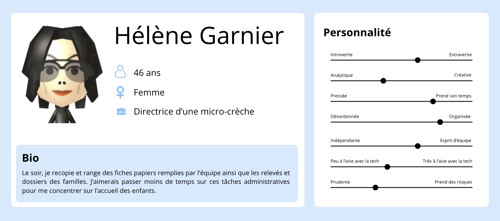
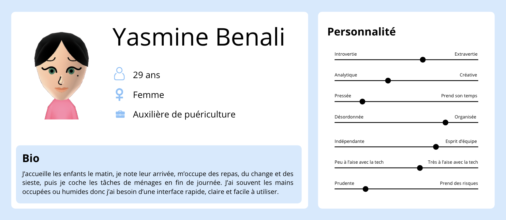
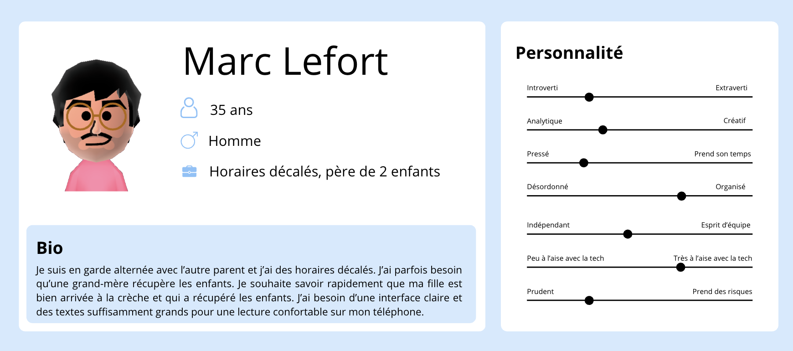
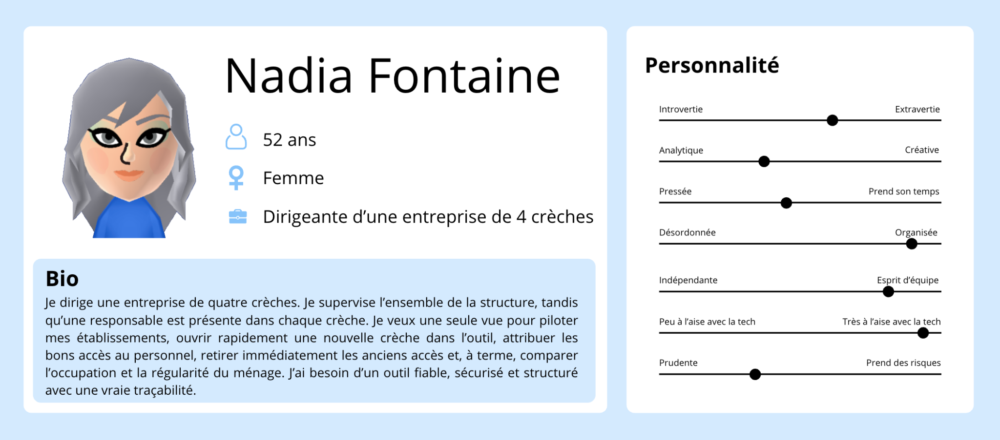
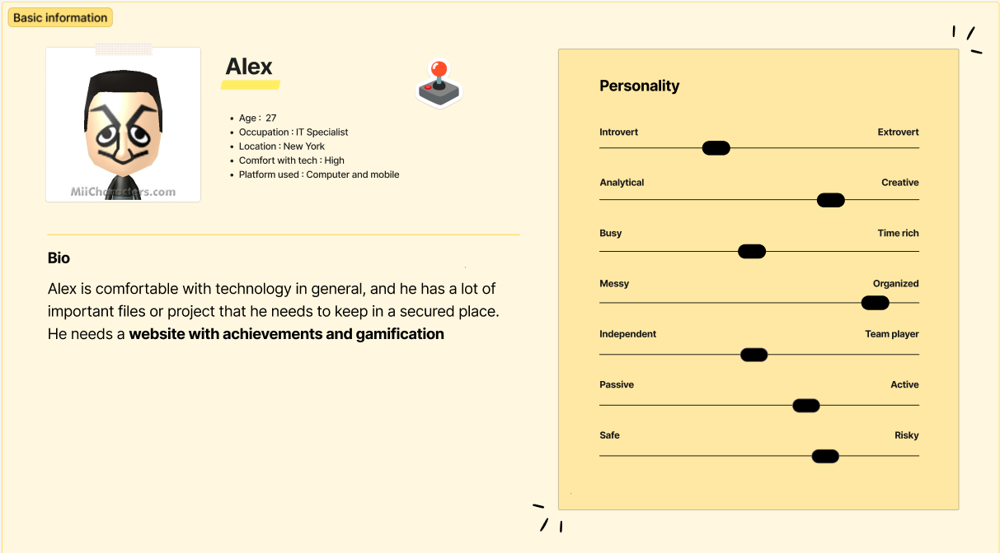
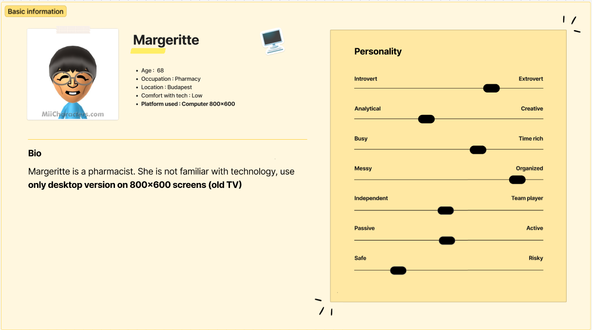

# Personas

Les personnes pour qui Luniqo est construit. Elles servent à trancher une
question produit (« est-ce qu'Hélène en a besoin pour le premier jour ? ») et
alimentent la [story map](STORY-MAP.md).

> **Personnages fictifs** `[SIMULÉ]`. Noms, âges, citations et détails de vie
> sont inventés. Ils s'appuient sur le terrain réel du projet : le besoin
> d'origine d'une micro-crèche (les fiches de ménage papier), le fonctionnement
> d'un établissement d'accueil du jeune enfant, et l'extension à des groupes de
> crèches. Aucun propos n'est attribué à une personne réelle. Chaque persona
> porte des **hypothèses à vérifier** auprès de vrais utilisateurs.

Rédigé le 2026-10-09 (LUN-60, bonus du cours « Coordination Front & Back »).
Complété le 2026-11-17 (LUN-126, TD « Road to MVP ») : fiches illustrées par
Pauline, et les deux personas imposés par le TD, Alex et Margeritte.

| | Persona | Origine | Rôle dans Luniqo | Appareil principal | Fréquence |
|---|---|---|---|---|---|
| 1 | [Hélène, directrice de micro-crèche](#1-hélène-garnier-directrice-dune-micro-crèche) | personnalisé | Direction (`owner`) | ordinateur de bureau, téléphone | chaque jour |
| 2 | [Yasmine, auxiliaire de puériculture](#2-yasmine-benali-auxiliaire-de-puériculture) | personnalisé | Employée (`employee`) | tablette de la crèche | plusieurs dizaines de fois par jour |
| 3 | [Marc, parent de deux enfants](#3-marc-lefort-parent-de-deux-enfants) | personnalisé | Famille (`guardian`) | téléphone | une ou deux fois par jour |
| 4 | [Nadia, gestionnaire d'un groupe de crèches](#4-nadia-fontaine-gestionnaire-dun-groupe-de-crèches) | personnalisé | Direction (`owner`) de plusieurs crèches | ordinateur portable | chaque jour |
| 5 | [Alex, référent numérique d'un groupe de crèches](#5-alex-référent-numérique-dun-groupe-de-crèches) 🕹️ | **imposé par le TD** (stats et gamification) | Direction (`owner`) aux côtés de Nadia | ordinateur et mobile | plusieurs fois par semaine |
| 6 | [Margeritte, grand-mère avec délégation d'autorité parentale](#6-margeritte-grand-mère-avec-délégation-dautorité-parentale) 🖥️ | **imposé par le TD** (écran 800×600) | Famille (`guardian`) | vieil ordinateur de bureau, écran 800×600 | quelques fois par semaine |

---

## 1. Hélène Garnier, directrice d'une micro-crèche

> « Le soir, je recopie et je range des fiches. Ce n'est pas pour ça que j'ai ouvert une crèche. »

| | |
|---|---|
| Âge | 46 ans |
| Structure | Micro-crèche de 10 places en périphérie d'une grande ville, 4 salariées |
| Rôle | Gérante et directrice ; elle encadre l'équipe et accueille les enfants une partie de la journée |
| Aisance numérique | Moyenne : bureautique, banque en ligne, messagerie. Peu de patience pour un outil qui « rame » |

**Sa journée.** Elle ouvre la crèche, accueille les premières familles,
remplace une salariée absente, puis fait l'administratif en fin de journée :
fiches de ménage remplies par l'équipe, relevés, dossiers des familles. Tout est
sur papier, dans des classeurs à conserver.

**Ce qu'elle veut**
- Ne plus remplir ni archiver de fiches papier, sans perdre la preuve que le ménage est fait.
- Savoir à tout moment quels enfants sont présents.
- Être sûre que seul un adulte autorisé repart avec un enfant.
- Retrouver vite une information lors d'un contrôle ou d'une question d'un parent.

**Ce qui la freine**
- Les doubles saisies (papier puis logiciel).
- Les logiciels pensés pour de grandes structures, trop complexes pour 10 places.
- Les mots de passe à rallonge et les codes envoyés par SMS qui n'arrivent pas.

**Ce que Luniqo doit faire pour elle** : fiche de ménage numérique avec
historique (épic « Fiche de ménage »), présents du jour (« Pointage sur
tablette »), autorisations de départ par enfant (« Enfants et familles »),
connexion rapide et sûre avec Face ID (« Authentification »).

**Ce qu'il ne faut pas faire** : lui imposer un paramétrage long avant le
premier usage ; multiplier les écrans de configuration.

**Hypothèses à vérifier**
- Les fiches de ménage doivent être conservées et présentables : combien de temps, sous quelle forme ?
- Elle accepte de faire pointer l'équipe sur une tablette plutôt que sur papier.

---

## 2. Yasmine Benali, auxiliaire de puériculture

> « Quand j'ai un bébé dans les bras, je n'ai pas le temps de chercher un bouton. »

| | |
|---|---|
| Âge | 29 ans |
| Poste | Auxiliaire de puériculture, à temps plein |
| Appareil | La tablette fixée près de l'entrée, partagée par toute l'équipe |
| Aisance numérique | Bonne sur téléphone, aucune envie de retenir un mot de passe de plus |

**Sa journée.** Elle accueille les enfants le matin, note leur arrivée,
s'occupe des repas, du change, des siestes, coche les tâches de ménage de la
salle en fin de journée et rend chaque enfant à la bonne personne. Elle a
souvent les mains occupées ou humides.

**Ce qu'elle veut**
- Pointer une arrivée ou un départ en quelques secondes, avec de grands boutons.
- Ne pas se tromper sur la personne qui vient chercher un enfant.
- Ne pas avoir à se reconnecter à chaque geste.

**Ce qui la freine**
- Les écrans chargés et les petits boutons.
- Devoir saisir un e-mail et un mot de passe sur une tablette partagée.

**Ce que Luniqo doit faire pour elle** : choisir son nom et taper un PIN de 4
chiffres, liste des enfants avec un geste par pointage, alerte si l'adulte n'est
pas autorisé, fiche de ménage à cocher (« Pointage sur tablette », « Fiche de
ménage »).

**Ce qu'il ne faut pas faire** : lui demander des informations de santé ou des
commentaires libres pendant le pointage ; afficher des données d'autres crèches.

**Hypothèses à vérifier**
- Une session de 2 minutes après le PIN suffit pour pointer plusieurs enfants d'affilée.
- Les fratries arrivent souvent ensemble : pointer deux enfants d'un geste ferait gagner du temps.

---

## 3. Marc Lefort, parent de deux enfants

> « Je veux juste savoir que ma fille est bien arrivée et qui est passé la chercher. »

| | |
|---|---|
| Âge | 35 ans |
| Famille | Deux enfants accueillis dans la même crèche ; garde alternée avec l'autre parent |
| Travail | Horaires décalés ; c'est parfois une grand-mère qui récupère les enfants |
| Accessibilité | Utilise le grossissement du texte de son téléphone |

**Ce qu'il veut**
- Voir la présence du jour et l'heure d'arrivée ou de départ de chacun de ses enfants.
- Savoir que les autres familles ne voient pas les informations de ses enfants.
- Un seul compte pour ses deux enfants.

**Ce qui le freine**
- Créer encore un compte avec un mot de passe compliqué.
- Les applications illisibles quand le texte est agrandi.

**Ce que Luniqo doit faire pour lui** : invitation par la crèche, choix du mot
de passe, consultation réservée à l'autorité parentale, un compte pour plusieurs
enfants (« Enfants et familles », portail des parents).

**Ce qu'il ne faut pas faire** : montrer les coordonnées des autres contacts de
l'enfant ; envoyer des données d'enfants par e-mail.

**Hypothèses à vérifier**
- Une notification à l'arrivée et au départ serait plus utile que la consultation.
- La grand-mère autorisée à venir chercher les enfants n'a pas besoin de compte.
  Contredite par [Margeritte](#6-margeritte-grand-mère-avec-délégation-dautorité-parentale)
  quand la grand-mère a une délégation d'autorité parentale.

---

## 4. Nadia Fontaine, gestionnaire d'un groupe de crèches

> « J'ai quatre crèches, je veux une seule vue, et chacun ne doit voir que la sienne. »

| | |
|---|---|
| Âge | 52 ans |
| Structure | Entreprise de 4 crèches (une crèche de 40 places, trois micro-crèches), une trentaine de salariés |
| Rôle | Dirigeante ; une responsable sur place dans chaque crèche |
| Aisance numérique | Bonne ; habituée aux outils de gestion et aux tableaux de bord |

**Ce qu'elle veut**
- Ouvrir une nouvelle crèche dans l'outil et donner les bons accès en quelques minutes.
- Qu'un salarié qui change de crèche perde immédiatement l'accès à l'ancienne.
- Comparer l'occupation et la régularité du ménage entre ses crèches.
- Être certaine que les données de ses crèches ne sont visibles par aucune autre entreprise.

**Ce qui la freine**
- Les outils pensés pour une seule structure, qui obligent à un compte par crèche.
- L'absence de traçabilité de qui a fait quoi.

**Ce que Luniqo doit faire pour elle** : plusieurs crèches par entreprise, accès
du personnel par crèche, second facteur obligatoire pour la direction (« Crèches
et personnel », « Authentification »), état de chaque crèche depuis l'accueil
(LUN-124), tableau de bord et statistiques plus tard.

**Hypothèses à vérifier**
- Les responsables de chaque crèche ont besoin d'un rôle intermédiaire entre direction et employé (non prévu aujourd'hui).

---

## 5. Alex, référent numérique d'un groupe de crèches

> **Imposé par le TD « Road to MVP »** : un besoin de statistiques et de
> gamification. La fiche du TD décrit un informaticien de 27 ans, à New York,
> très à l'aise avec la technique, sur ordinateur et mobile, qui garde des
> fichiers importants dans un endroit sécurisé et veut « un site avec des succès
> et de la gamification ». Pour Luniqo, il devient le référent numérique du
> groupe de Nadia ; l'âge, le métier et l'aisance numérique sont ceux de la fiche.

> « Si l'équipe voit sa progression, elle remplit les fiches. Si c'est une corvée, elle oublie. »

| | |
|---|---|
| Âge | 27 ans |
| Poste | Informaticien, référent numérique du groupe de 4 crèches de Nadia : il installe les outils, forme les équipes et répond aux questions |
| Appareils | Ordinateur au bureau, téléphone en déplacement entre les crèches |
| Aisance numérique | Élevée ; actif, organisé, prêt à essayer de nouvelles fonctions |

**Sa semaine.** Il passe d'une crèche à l'autre pour mettre en route les outils :
activer la double authentification de la direction, enrôler les tablettes,
faire remplir la première fiche de ménage. Il veut savoir où en est chaque
crèche sans téléphoner à chaque responsable, et donner envie aux équipes
d'utiliser l'outil au quotidien.

**Ce qu'il veut**
- Suivre la mise en route de chaque crèche par étapes visibles, avec des succès débloqués.
- Des statistiques entre crèches : occupation, régularité du ménage, classement.
- Des données bien protégées : voir les sessions actives et l'historique des connexions de son compte.
- Encourager les équipes par des séries et des badges de régularité.

**Ce qui le freine**
- Un outil qui ne montre pas ce qui reste à faire.
- Des fonctions cachées derrière une configuration qu'il doit expliquer à chaque crèche.
- L'absence de trace de qui s'est connecté et d'où.

**Ce que Luniqo doit faire pour lui** : succès de mise en route d'une crèche
(LUN-128, US de l'équipe : succès côté API LUN-130, page de mise en route
LUN-131), sessions actives et historique des connexions (à créer), séries et
badges de régularité du ménage (à créer), statistiques multi-crèches avec
classement (à créer, « plus tard »).

**Ce qu'il ne faut pas faire** : transformer le pointage ou le ménage en
compétition entre salariées nommément ; afficher des données d'enfants dans les
statistiques ; récompenser la quantité au détriment de l'exactitude (cocher pour
cocher).

**Hypothèses à vérifier**
- Des succès de mise en route raccourcissent l'installation d'une nouvelle crèche.
- Les équipes acceptent des badges collectifs (par crèche) mais pas individuels.

---

## 6. Margeritte, grand-mère avec délégation d'autorité parentale

> **Imposé par le TD « Road to MVP »** : un besoin d'écran cathodique en
> 800×600. La fiche du TD décrit une pharmacienne de 68 ans, à Budapest, peu à
> l'aise avec la technique, qui n'utilise qu'un ordinateur de bureau avec un
> écran 800×600 (« vieille télé »), sans version mobile. Pour Luniqo, elle
> devient une grand-mère qui a une délégation d'autorité parentale et récupère
> ses petits-enfants ; l'âge, le métier et l'équipement sont ceux de la fiche.

> « Je veux juste vérifier l'heure de sortie des petits, sans chercher où cliquer. »

| | |
|---|---|
| Âge | 68 ans |
| Situation | Pharmacienne ; ses petits-enfants sont accueillis en crèche, elle a une délégation d'autorité parentale de leurs parents |
| Équipement | Un ordinateur de bureau ancien, écran 800×600 ; pas de smartphone pour ce genre d'usage |
| Aisance numérique | Faible ; prudente, organisée, préfère imprimer |

**Sa semaine.** Elle récupère les enfants deux soirs par semaine quand leurs
parents travaillent tard. Le soir, elle consulte le portail depuis son
ordinateur pour vérifier les heures d'arrivée et de départ, et garde une trace
papier des jours où elle s'en est occupée.

**Ce qu'elle veut**
- Un portail lisible sur un écran 800×600 : pas de défilement horizontal, gros caractères, contrastes forts.
- Voir la présence du jour et l'historique de chaque enfant, sans menus cachés.
- Imprimer un relevé de présence en PDF très contrasté.
- Un compte à elle, puisque la délégation lui donne le droit de consulter.

**Ce qui la freine**
- Les sites pensés pour le téléphone, qui débordent ou cachent les menus sur un petit écran de bureau.
- Les icônes sans texte et les actions au survol.
- Les procédures de connexion en plusieurs étapes sur un autre appareil.

**Ce que Luniqo doit faire pour elle** : portail des parents (LUN-68)
utilisable en 800×600 et avec le texte agrandi (à créer), relevé de présence en
PDF contrasté (à créer), compte famille lié à sa délégation.

**Ce qu'il ne faut pas faire** : exiger un smartphone (application
d'authentification, notification) pour consulter ; mettre l'information
essentielle hors de la zone visible en 800×600 ; afficher des données de santé.

**Hypothèses à vérifier**
- Une grand-mère avec délégation d'autorité parentale a besoin de son propre compte : cela contredit l'hypothèse de [Marc](#3-marc-lefort-parent-de-deux-enfants).
- Un relevé imprimable lui suffit, sans notification.
